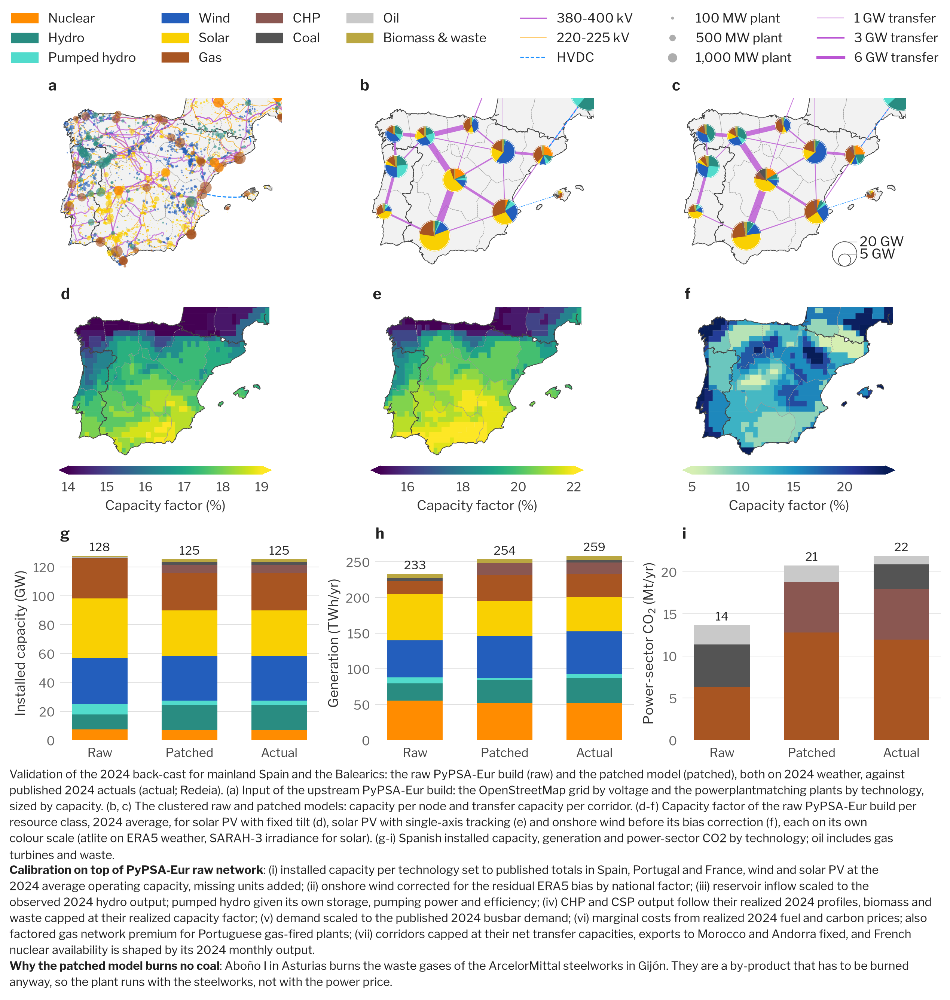

# Spain Datacenter Decree

A study of Spain's proposed 80% hourly matching (24/7 CFE) requirement for new data
centers: a PyPSA model of today's Spanish electricity system (2025 fleet), built on
[PyPSA-Eur](https://github.com/PyPSA/pypsa-eur), with data center PPA & 24/7-CFE
procurement model following [PyPSA/247-cfe](https://github.com/PyPSA/247-cfe) and the
previous research of [Riepin & Brown (2024)](https://doi.org/10.1016/j.esr.2024.101488).

The modelling was done on 18–21 October 2026 to
quantify what the
[draft royal decree](https://www.miteco.gob.es/es/energia/participacion/2026/detalle-participacion-publica-k-851.html)
of August 2026 would mean for Spain's electricity system, in the open and for the public
interest. On 27 October 2026 the repository was updated to represent the transition rules
of the revised draft of 26 October 2026; see
[Update: the revised draft of 26 October 2026](#update-the-revised-draft-of-26-october-2026).

## Why this study?

The next decade of digital infrastructure will be built somewhere and powered by
something. Spain is deciding how. A
[draft royal decree](https://www.miteco.gob.es/es/energia/participacion/2026/detalle-participacion-publica-k-851.html)
would require new data centers (from 1 MW of grid access) to back, in every hour, at
least 80% of their consumption with renewable electricity generated that same hour by
new Spanish installations, with forfeiture of grid access on non-compliance. The stakes
are measured in gigawatts: data centers hold 6.3 GW of granted transmission access
([Red Eléctrica access map via pv magazine](https://www.pv-magazine.es/2026/10/02/red-electrica-asigna-633-gw-de-acceso-a-centros-de-datos-el-34-de-los-1852-gw-otorgados-a-la-demanda/), Oct 2026), and
more than 12 GW of access and connection rights granted since 2021 ([MITECO](https://www.miteco.gob.es/content/dam/miteco/es/prensa/20260827_NdP_El_Gobierno_plantea_impulsar_los_centros_de_datos_sostenibles.pdf),
Aug 2026).

The policy's logic: additional demand must bring additional clean supply, matched at the
hours it actually consumes. Done right, this makes new load a system asset. It finances
new wind, solar and storage, caps its own marginal emissions, and hedges the operator
against wholesale price volatility. Without it, every new flat gigawatt is served by the
gas margin: higher emissions, deeper gas import dependency, higher consumer prices, and
data centers exposed to every price swing. Bad for Spanish society, and bad for the data
center operators themselves.

This study provides a transparent, quantitative assessment of the policy's impact. The
repository contains a dispatch model of today's Spanish electricity system, validated
against actual data, in which a new data center procures renewable electricity under the
proposed 80% hourly matching rule and alternative procurement policies. It measures system
costs, emissions, prices and the procurement portfolio against a baseline without the data
center, so that both the Spanish government and the data center industry can see what the
policy does before it takes effect.

This work is done in the open and in the public interest. Every input number is cited and
linked to its primary source; every correction to the model is documented, switchable and
re-validated; every figure and table in this repository can be reproduced from scratch
with the included scripts. Anyone, from a ministry analyst to an independent research
group, can check the numbers, challenge them, and build on them.

## Results

> The results show that dropping the decree's core rule, that new data centers match
> their consumption *hour by hour* with power from *new* renewable and storage assets,
> is a lose-lose outcome for Spain and for data centers. Without it, the demand of a new
> data center is met mostly by gas power plants. Take one example: a 500 MW data center
> in Aragon (a small part of the 6.3 GW of grid access data centers already hold) makes
> Spain burn 10% more gas for power, emit about 1 Mt more CO2 a year, and pay almost 300
> M€ more a year to run its power system. Gas sets the price, so the spot price rises by
> about 2 €/MWh for every consumer, the data center included. With hourly matching in
> place, as the decree writes it or as it is usually defined, that rise and the added
> emissions shrink by 80% or more, and the data center covers at least 80% of its use
> with its own renewable and storage contracts, shielded from the gas-set spot price.
> How emissions are counted matters: the average grid mix suggests about 70 gCO2/kWh for
> the data center's consumption (attributional), while the actual change in emissions is
> four times larger (consequential), because gas serves the new demand.
>
> One clause of the draft decree needs fixing: it asks for 80% *in every hour*, not 80%
> *hour by hour* over the year, the usual meaning of hourly matching (as in
> [Google's CFE score](https://sustainability.google/reports/24x7-carbon-free-energy-methodologies-metrics/)).
> Meeting 80% in every hour means covering even the darkest, calmest winter hours, which
> takes a portfolio that overshoots the rest of the time: it reaches about 98% under the
> usual definition and costs the data center more than buying from the grid. With that
> one fix, the decree delivers most of the social benefits at a low cost to the data
> center industry, and cuts Spain's dependence on imported gas and the data centers'
> exposure to gas price swings.

A showcase snapshot of the study figures for a selected case, a 500 MW data center in
Aragon, each with its caption, is in [doc/showcase](doc/showcase):

- [Spanish system impact](doc/showcase/system_impact.png): system cost, emissions,
  electricity sector gas burn and spot price against a baseline without the data center
- [Hourly clean coverage](doc/showcase/dc_clean_coverage.png): the share of the data
  center's consumption covered by renewables in the same hour
- [Procurement portfolio](doc/showcase/dc_portfolio.png): contracted wind, solar and
  battery, and their electricity yield and curtailment
- [Data center cost](doc/showcase/dc_cost.png): the cost per MWh consumed
- [Emission intensity](doc/showcase/dc_emission_intensity.png): consequential and
  attributional CO2 per kWh consumed
- [Shift in Spanish supply](doc/showcase/system_generation_shift.png): what serves the
  data center's consumption
- Hourly CFE score and emission intensity of the data center's consumption:
  [no policy](doc/showcase/heatmap_unmatched_dc_spain_wide.png),
  [decree](doc/showcase/heatmap_strict_hourly_80_ppa_only_spain_wide.png),
  [hourly 80% on average](doc/showcase/heatmap_hourly_80_ppa_only_spain_wide.png),
  [with grid credit](doc/showcase/heatmap_hourly_80_grid_credit_spain_wide.png),
  [local](doc/showcase/heatmap_hourly_80_ppa_only_local_region.png),
  [annual 80%](doc/showcase/heatmap_annual_80_res_spain_wide.png)
- [Raw summary csv](doc/showcase/scenarios.csv)

Running the [workflow](#workflow) writes the full set to `results/`: solved networks,
summary CSVs and plots for every scenario.

## Model

Every modelling choice favors verifiability:

- Base model: PyPSA-Eur v2026.09.0 as a pinned git submodule. No upstream file is
  modified; every study choice lives in the `config/` overlay and this repository.
- Geography: 15 nodes, with 9 in Spain (8 mainland + Balearics), 4 in France and
  2 in Portugal.
- France's outer borders (GB, IT, CH, DE+BE combined): fixed to measured hourly
  2024 flows (RTE eCO2mix via ODRE).
- Temporal resolution: full year at hourly resolution (8760 snapshots). For quick runs,
  average to 3 hours with `clustering.temporal.averaging: 3h` in `config/config.spain.yaml`
  before the upstream build, or with PyPSA's
  [temporal clustering](https://docs.pypsa.org/latest/user-guide/clustering/#temporal-clustering)
  (`n.cluster.temporal.resample("3h")`) on a built network.
- Techno-economic assumptions:
  [technology-data v0.15.0](https://github.com/PyPSA/technology-data/tree/v0.15.0) in EUR2025.
- Renewable resources: five
  [resource classes](https://pypsa-eur.readthedocs.io/en/latest/configuration/#renewable)
  per modelled region for onshore wind and utility solar PV (split into fixed optimally tilted
  and single-axis tracking), each with its own profile and potential. Existing plants are
  spatially joined to the class where they stand. PPA candidates take the best class with
  remaining potential at each node; the optimizer chooses what to contract.
- Fleet: frozen background fleet, calibrated to cited national data
  (`data/custom/*.csv`; every number sourced in `doc/data_sources.md`). Only the data
  center's PPA and battery assets are extendable.
- Solver: HiGHS (open source, no license needed), set in `spain_cfe.solving.solver`.
  A full-year solve needs ~4 GB RAM at 3-hourly resolution and ~10 GB at the hourly
  resolution of the study results.

## Scenario options

Each scenario suite in `config/config.spain.yaml` mixes and matches these ready-made
options:

- Procurement policy: no policy at all (`unmatched_dc`); the decree, 80% in
  every hour (`strict_hourly_80_ppa_only`); 80% hourly matching on average over the year
  (`hourly_80_ppa_only`), optionally with credit for the grid's renewable share
  (`hourly_80_grid_credit`); or annual volume matching (`annual_80_res`). Need a different
  score? Change the number in the name: `hourly_90_ppa_only` asks for 90%,
  `annual_100_res` for 100%.
- PPA location: the data center signs its PPAs anywhere in
  mainland Spain (`spain_wide`) or only in its own region (`local_region`).
- Data center cluster size: a flat load of any size. The full suite runs 500,
  2000, 4000 and 6000 MW.
- Data center site: any of the 9 Spanish regions, Aragón by
  default.
- Sales of surplus electricity: off by default, so the data center stores or
  curtails what it cannot use. Switch them on to let it sell surplus back to the grid.
- Weather year: this version of the project uses wy2024. The PyPSA-Eur and
  [atlite](https://github.com/PyPSA/atlite) workflow can build any other weather year from
  [ERA5](https://www.ecmwf.int/en/forecasts/dataset/ecmwf-reanalysis-v5) reanalysis data,
  with SARAH-3 satellite data for solar.

### Update: the revised draft of 26 October 2026

With a new draft released on 26 October 2026 introducing a five-year transition for data
centers that join the grid operator's automatic load-reduction scheme (DT1: the hourly
floor applies only in tariff periods P1 and P2 of the access tariffs, hour by hour, and
all other hours are unconstrained), we include two new scenario options to represent it,
called `transition_p1_60` (60% in tariff period P1, to 2028) and `transition_p1_70_p2_60`
(70% in P1 and 60% in P2, from 2029). `scripts/tariff_periods.py` holds the period
calendar of CNMC Circular 3/2020 (P1: 9–14 h and 18–22 h on weekdays in January,
February, July and December; P2: 8–9, 14–18 and 22–24 h on those days, and 9–14 h and
18–22 h on weekdays in March and November; local time, national holidays excluded). They
run as a suite of their own, `draft_2026_10`, with its table and figures under
`results/draft_2026_10/`; see the workflow command below.

## Study stages

The study keeps what we measure strictly separate from what we assume. The `{year}`
wildcard is the data vintage; the run is the weather year. Fleet, demand, price and NTC
patches read rows for `{year}`; hydro inflow keys on the run's weather year; the France
border flows are the measured 2024 series in every run; the wind-bias factor is derived on
the back-cast and applied to other data years as fixed cited constants.

| Stage | run (weather) | `{year}` (data) | variant | artifacts |
|---|---|---|---|---|
| (i) raw + validation | wy2024 | 2024 | raw | `base_2024_raw.nc` → `validation_raw` |
| (ii) back-cast calibration + validation | wy2024 | 2024 | patched | `base_2024_patched.nc` → `validation_patched` |
| (iii) case study | wy2024 | 2025 | patched | `base_2025_patched.nc` → DC procurement-policy solves → `scenarios.csv` |
| (iv) weather-year sensitivities (open for extension) | wy2010 / wy2013 / wy2020 | 2025 | patched | `base_2025_patched.nc` per run → DC procurement-policy solves → `scenarios.csv` |

On the wy2024 reference the case study uses every weather-dependent closure in-sample:
measured 2024 border flows with 2024 weather, observed 2024 hydro energy, and the
wind-bias factor derived on the back-cast (stage ii) and applied as a fixed cited
constant (`data/custom/wind_correction.csv`) in stage (iii).

## Setup

Install [pixi](https://pixi.sh), then:

```bash
git clone --recursive https://github.com/pypsalabs/spain-datacenter-decree.git
cd spain-datacenter-decree
```

The study deliberately has no environment of its own: it runs entirely in the submodule's
pixi environment (`pypsa-eur/pixi.toml` + lock file), so the upstream build and the study
workflow always use exactly the package versions the pinned PyPSA-Eur release was tested
with.

## Workflow

Two commands run everything (incl. installation of the pinned environment).

```bash
# full case study: upstream build, scenario solves, summary, figures
pixi run --manifest-path pypsa-eur/pixi.toml snakemake -c all
# the revised draft's version, with its own table and figures under results/draft_2026_10/
pixi run --manifest-path pypsa-eur/pixi.toml snakemake -c all --configfile config/suite.draft_2026_10.yaml

# 2024 back-cast and its validation reports (not needed for the case study)
pixi run --manifest-path pypsa-eur/pixi.toml snakemake validation -c all
```

Every intermediate target (prepared network, single scenario solve, report) stays
addressable by its filename; see `Snakefile`. For interactive work, activate the
environment with `pixi shell --manifest-path pypsa-eur/pixi.toml`.

## Validation

`prepare_network.py` corrects the PyPSA-Eur network with cited data, each patch switchable
under `spain_cfe.patches`: build the system, validate it against 2024 actuals, correct
only what the validation demands, and re-validate through the same pipeline.

Raw PyPSA-Eur and the model patched with cited data corrections are compared against
Redeia's reported 2024 numbers in two forms. The visual report below shows the
transmission grid and power plants, the 15-node network before and after patching, the
capacity factors of the wind and solar resource classes, and Spanish capacity,
generation and CO2 emissions by technology. Full metric tables
([validation_raw.csv](results/validation/validation_raw.csv),
[validation_patched.csv](results/validation/validation_patched.csv)) also track
cross-border flows, capacity factors and more. All are tracked and regenerated with
`snakemake validation` whenever the model changes.



Thanks to [Lukas Franken](https://github.com/LukasFrankenQ) for contributing to the
calibration visualisation.

## License

MIT © 2026 Iegor Riepin (PyPSA Labs gGmbH); see [LICENSES/](LICENSES/),
[REUSE](https://reuse.software/)-compliant. Vendored
third-party primary sources under `data/custom/sources/` keep their providers' licences,
registered per file in [doc/data_sources.md](doc/data_sources.md).

## Independence

This project is independent work: Iegor Riepin and PyPSA Labs gGmbH received no funding,
no grant and no direction for it, from any government, company or interest group. The
modelling work was done because Spain is about to take a decision of lasting consequence,
and a decision of that weight deserves open, verifiable evidence that belongs to everyone.
